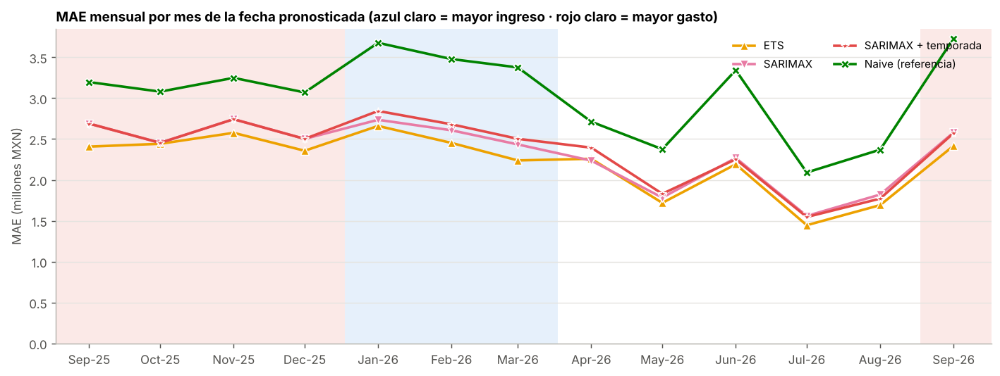
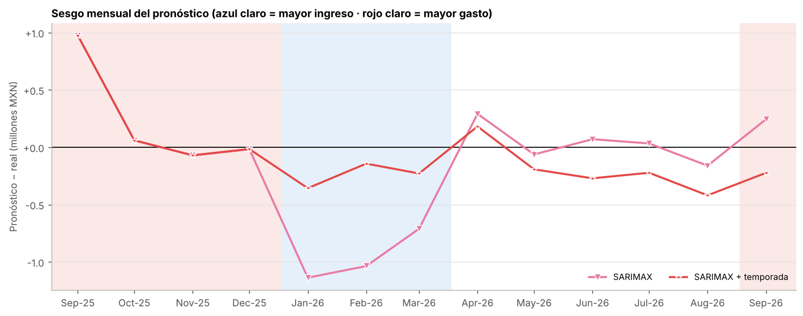

# Predictor de flujo de efectivo con modelos de Hugging Face

En este proyecto construí un predictor del flujo de efectivo diario a partir de los movimientos bancarios que exporta SAP en la transacción FEBAN. Comparo dos modelos fundacionales de series de tiempo publicados en Hugging Face, Chronos-2 y Chronos-Bolt Small, contra dos modelos estadísticos clásicos, ETS y SARIMAX, y contra un pronóstico ingenuo que repite el último día observado.

## Descripción del proyecto

Tesorería necesita saber cuánto efectivo va a entrar y salir en los próximos días para decidir traspasos entre bancos, inversiones de excedentes y pagos. El punto de partida es un export FEBAN con los movimientos de una cuenta en BBVA y otra en HSBC, del 01-09-2025 al 30-09-2026. Solo una semana es real; el resto lo completé con datos ficticios coherentes con esa semana, con más ingreso de enero a marzo y más gasto de septiembre a diciembre. En [`data/README.md`](data/README.md) explico cómo se armó el archivo y cómo lo anonimicé.

Antes de pronosticar, el pipeline elimina las partidas repetidas por cargas múltiples del mismo extracto y separa los movimientos de tesorería (barridos, inversiones en fondos y traspasos entre bancos propios), porque no son flujo del negocio. Con lo que queda arma cuatro series en días hábiles: `OPERATIVO_TOTAL`, que es la serie principal, `OPERATIVO_BBVA`, `OPERATIVO_HSBC` y `NETO_TOTAL`, que incluye la tesorería.

| Modelo | Tipo | Fuente | Tamaño | Licencia |
|---|---|---|---|---|
| Chronos-2 | Fundacional *zero-shot*, univariado y multivariado, con covariables | [`amazon/chronos-2`](https://huggingface.co/amazon/chronos-2) | 120 M de parámetros | Apache-2.0 |
| Chronos-2 + temporada | Chronos-2 con la covariable de temporada en `future_df` | mismos pesos | 120 M | Apache-2.0 |
| Chronos-2 (cross-learning) | Chronos-2 pronosticando las cuatro series en conjunto | mismos pesos | 120 M | Apache-2.0 |
| Chronos-Bolt Small | Fundacional *zero-shot*, univariado | [`amazon/chronos-bolt-small`](https://huggingface.co/amazon/chronos-bolt-small) | 48 M de parámetros | Apache-2.0 |
| ETS | Suavizamiento exponencial con error aditivo, tendencia amortiguada y ciclo de 5 días | `statsmodels` | cerca de 10 parámetros por serie | BSD-3-Clause |
| SARIMAX | ARIMA estacional con regresores de calendario | `statsmodels` | cerca de 11 parámetros por serie | BSD-3-Clause |
| SARIMAX + temporada | SARIMAX con la covariable de temporada en `exog` | `statsmodels` | cerca de 13 parámetros por serie | BSD-3-Clause |
| Ingenuo (referencia) | Mañana igual a hoy | | | |

La covariable de temporada son dos indicadores que se conocen de antemano: ingreso alto de enero a marzo y gasto alto de septiembre a diciembre. Comparar cada modelo con y sin ella muestra si anticipa el cambio de temporada o lo detecta tarde. Solo la uso en un origen cuando la historia ya contiene al menos 10 días hábiles de cada temporada que aparece en el horizonte, para que el modelo no extrapole a una temporada que nunca ha visto.

La evaluación es un backtest *walk-forward*: en cada uno de 276 orígenes, cada modelo usa solo la historia hasta ese día y pronostica los siguientes 5 días hábiles, lo que da 5,520 pronósticos por modelo. Mido el error con MAE, sesgo, RMSE, sMAPE, el MAE relativo al ingenuo (rMAE) y, para los cuantiles P10, P50 y P90, la pérdida de cuantiles ponderada (WQL) y la cobertura del intervalo. Como el ejercicio pedía accuracy, precision, recall y F1, convierto cada pronóstico en la decisión que tomaría tesorería en tres eventos: si el flujo sube respecto al último día, si será un día de flujo alto y si habrá déficit. También mido la latencia por llamada, la carga del modelo, la memoria de GPU y cómo crece el tiempo con 1, 16 y 64 series, y separo las métricas antes y desde el 01-09-2026, cuando empieza la temporada de mayor gasto.

## Estructura del repositorio

```
predictor-flujo-efectivo/
├── README.md
├── requirements.txt
├── data/
│   ├── README.md                     origen, columnas y anonimización
│   └── DEPOSITOS_CARGADOS_FEBAN_sep2025_sep2026_anon.xlsx
├── notebooks/
│   └── predictor_flujo_efectivo_chronos.ipynb   cuaderno completo para Colab
├── src/
│   ├── ejecutar_backtest.py          corre todo y guarda results/
│   └── flujo_efectivo/
│       ├── config.py                 parámetros (celda 4.1 del cuaderno)
│       ├── datos.py                  lectura, deduplicación, clasificación y series
│       ├── covariables.py            temporada y calendario
│       ├── modelos.py                Chronos, ETS, SARIMAX e ingenuo con una sola interfaz
│       ├── backtest.py               walk-forward y pronóstico hacia adelante
│       ├── metricas.py               regresión, clasificación y periodos
│       ├── latencia.py               latencia y escalabilidad
│       ├── graficas.py               figuras en PNG
│       ├── reporte.py                lectura de la corrida y exportación a Excel
│       └── entorno.py                GPU, semillas y versiones
└── results/
    ├── README.md
    ├── lectura_corrida.md
    ├── resultados_predictor_flujo.xlsx
    ├── corrida.json
    ├── tablas/                       CSV de cada tabla del cuaderno
    └── figuras/                      PNG de cada gráfica
```

El cuaderno es la versión principal del trabajo. El código de `src/` es el mismo, separado en módulos para correrlo sin Jupyter; comprobé que los dos dan exactamente los mismos pronósticos para los modelos estadísticos.

## Entorno de ejecución

El cuaderno está pensado para Google Colab con GPU T4. En una T4 Chronos corre en `float32`, porque esa tarjeta no tiene soporte nativo de `bfloat16`; en L4 o A100 el cuaderno cambia solo a `bfloat16`. También funciona en CPU, porque los modelos son pequeños, aunque entonces la latencia de Chronos no es representativa. ETS y SARIMAX siempre corren en CPU.

Hace falta Python 3.10 o superior. Estas son las versiones con las que probé el código:

| Paquete | Versión |
|---|---|
| Python | 3.13 |
| chronos-forecasting | 2.3.2 |
| torch | 2.14.1 |
| transformers | 4.57.6 |
| huggingface_hub | 0.36.2 |
| statsmodels | 0.15.0 |
| scikit-learn | 1.9.1 |
| pandas | 3.0.5 |
| numpy | 2.5.3 |
| matplotlib | 3.11.2 |
| openpyxl | 3.1.5 |

Los dos modelos de Hugging Face son públicos, así que el token es opcional. Autenticarse evita los límites de descarga anónima; en Colab se guarda en Secrets con el nombre `HF_TOKEN` y en local se define como variable de entorno.

Con la configuración por omisión, la parte estadística tarda unos 7 minutos en una CPU de 2 vCPU. El cuaderno completo en CPU tarda entre 15 y 30 minutos, casi todo por SARIMAX; Chronos en GPU tarda pocos minutos.

## Pasos de ejecución

### En Google Colab

1. Abre el cuaderno desde GitHub en `https://colab.research.google.com/github/<usuario>/predictor-flujo-efectivo/blob/main/notebooks/predictor_flujo_efectivo_chronos.ipynb`, cambiando `<usuario>` por la cuenta donde quede el repositorio.
2. En *Entorno de ejecución → Cambiar tipo de entorno de ejecución* elige GPU T4.
3. Si tienes token de Hugging Face, guárdalo en Secrets como `HF_TOKEN` y dale acceso al cuaderno.
4. Para los datos, agrega una celda al inicio con `!git clone https://github.com/<usuario>/predictor-flujo-efectivo.git`; el cuaderno busca el Excel en `predictor-flujo-efectivo/data/`. Si no lo clonas, al llegar a la celda 4.2 te pide subir el archivo.
5. Ejecuta *Entorno de ejecución → Ejecutar todas*. Al terminar se descarga `resultados_predictor_flujo.xlsx` con todas las tablas.

### En local con Jupyter

```bash
git clone https://github.com/<usuario>/predictor-flujo-efectivo.git
cd predictor-flujo-efectivo
python -m venv .venv
source .venv/bin/activate          # en Windows: .venv\Scripts\activate
pip install -r requirements.txt
jupyter notebook notebooks/predictor_flujo_efectivo_chronos.ipynb
```

El cuaderno encuentra el Excel en `../data/`. La celda de instalación con `%pip` se puede saltar si ya instalaste `requirements.txt`.

### Desde la línea de comandos

```bash
python src/ejecutar_backtest.py                          # los ocho modelos
python src/ejecutar_backtest.py --sin-chronos            # solo ETS, SARIMAX e ingenuo, sin descargar pesos
python src/ejecutar_backtest.py --max-origenes 40 --sin-latencia   # prueba rápida
```

El script repite el flujo del cuaderno y guarda las tablas, las figuras, el Excel de resultados y un resumen de la corrida en `results/`. Estas son sus opciones:

| Opción | Uso |
|---|---|
| `--excel RUTA` | Otro export FEBAN con las mismas columnas |
| `--salida CARPETA` | Carpeta de resultados (por omisión `results/`) |
| `--sin-chronos` | Omite Chronos-2 y Chronos-Bolt Small |
| `--chronos2`, `--chronos-bolt` | Repositorio de Hugging Face o carpeta local con los pesos |
| `--horizonte N` | Días hábiles por pronóstico (5) |
| `--max-origenes N` | Orígenes del backtest (280; con este archivo hay 276) |
| `--fecha-corte AAAA-MM-DD` | Fecha que separa las métricas por periodo (2026-09-01) |
| `--sin-latencia` | No mide latencia ni escalabilidad |
| `--cpu` | Corre Chronos en CPU aunque haya GPU |

Los demás parámetros (cuantiles, meses de cada temporada, días mínimos para usar la covariable, frecuencia de re-estimación de SARIMAX y reglas para separar la tesorería) están en la celda 4.1 del cuaderno y en `src/flujo_efectivo/config.py`. Con otro export, lo primero que hay que revisar son las reglas de tesorería, con la lista de cuentas propias de la empresa.

## Resultados

Los resultados de [`results/`](results/) salen del script en CPU. Los de Chronos-2 y Chronos-Bolt Small están pendientes: en el entorno donde armé el repositorio no pude descargar los pesos, así que solo validé su código con modelos diminutos de pesos aleatorios. Para completarlos hay que correr el cuaderno en Colab o el script en una máquina con acceso a Hugging Face.

| Modelo | MAE (M MXN) | rMAE | MAE desde 01-09-2026 (M MXN) | WQL | Cobertura P10–P90 | F1 dirección | Latencia mediana |
|---|---|---|---|---|---|---|---|
| ETS | 2.21 | 0.73 | 2.42 | 0.634 | 84 % | 0.70 | 0.24 s |
| SARIMAX | 2.33 | 0.76 | 2.58 | 0.650 | 83 % | 0.68 | 2.34 s |
| SARIMAX + temporada | 2.36 | 0.77 | 2.57 | 0.650 | 82 % | 0.69 | 5.40 s |
| Ingenuo (referencia) | 3.05 | 1.00 | 3.73 | 1.018 | 93 % | 0.00 | 0.01 s |
| Chronos-2 (tres variantes) | pendiente | | | | | | |
| Chronos-Bolt Small | pendiente | | | | | | |

El MAE se mide sobre las cuatro series y los cinco pasos del horizonte. La latencia es por llamada, pronosticando las cuatro series con toda la historia.



En todos los modelos el error es mayor en las dos temporadas marcadas que en los meses normales, y ETS tiene el menor error en 12 de los 13 meses; la excepción es abril, donde SARIMAX queda apenas por debajo.



Sin la covariable, SARIMAX subestimó el flujo de enero a marzo y lo sobreestimó al entrar a septiembre de 2026. Con ella, el sesgo promedio de enero a marzo baja de −0.96 a −0.24 M MXN diarios y en septiembre cambia de signo, aunque el MAE de esos meses no mejora.

## Conclusiones

Este ejercicio me permitió construir de principio a fin un predictor de flujo de efectivo a partir de movimientos bancarios y comparar dos modelos fundacionales de Hugging Face, Chronos-2 y Chronos-Bolt Small, contra ETS y SARIMAX. Lo primero que aprendí es que la preparación de los datos pesa tanto como el modelo. El export FEBAN repetía cada partida tantas veces como cargas tenía el extracto, lo que inflaba el flujo entre 6 y 19 veces. Además, tuve que separar los barridos, las inversiones en fondos y los traspasos entre bancos, porque son decisiones de tesorería y no flujo del negocio.

De los modelos que pude medir, ETS fue el mejor. Tuvo un error medio de 2.21 M MXN por pronóstico, 27 % menos que el pronóstico ingenuo, el mejor intervalo y menos de medio segundo por corrida en CPU. SARIMAX, con y sin covariable, tardó entre 10 y 23 veces más y tuvo más error. Me sorprendió que la diferencia de precisión entre modelos fuera de apenas 7 %, frente a una diferencia de costo tan grande. Con un ruido diario cercano a 3 M MXN y casi sin memoria de un día a otro, lo más que puede hacer un modelo es estimar bien el nivel del flujo, y en ese terreno uno sencillo compite muy bien.

La covariable de temporada no mejoró el error promedio de SARIMAX, pero sí corrigió su sesgo al entrar a la temporada de mayor gasto: en septiembre pasó de sobreestimar 0.24 M MXN diarios a subestimar 0.22. También vi que una covariable mal planteada empeora el modelo. En la primera versión, SARIMAX extrapoló en abril y su error de ese mes subió de 2.24 a 3.26 M MXN, por lo que limité su uso a temporadas que ya aparecen en la historia.

El trabajo tiene dos limitaciones. La mayor parte de la historia es simulada, porque solo contaba con seis días hábiles de datos reales, y los modelos Chronos todavía no se evalúan con sus pesos publicados en GPU. Por eso recomiendo ETS para producción y dejo a Chronos-2 con covariable de temporada como alternativa, que solo lo sustituiría si reduce el error al menos 5 % y cumple los umbrales que definí. Como siguiente paso quiero repetir el pipeline con un año de movimientos reales y agregar como covariables los flujos que tesorería conoce de antemano, para ver si Chronos-2 los aprovecha mejor que los métodos clásicos.

## Confidencialidad de los datos

El Excel del repositorio está anonimizado: los nombres de clientes y proveedores, las cuentas CLABE y los números de cuenta y contrato que traían los conceptos bancarios se cambiaron por valores ficticios, sin tocar importes, fechas ni las palabras que usa la clasificación. Los exports originales no se suben; el `.gitignore` excluye cualquier export FEBAN que no termine en `_anon.xlsx`.

## Referencias

- Amazon. (s. f.). *amazon/chronos-2* [Ficha del modelo]. Hugging Face. https://huggingface.co/amazon/chronos-2
- Amazon. (s. f.). *amazon/chronos-bolt-small* [Ficha del modelo]. Hugging Face. https://huggingface.co/amazon/chronos-bolt-small
- Seabold, S. y Perktold, J. (2010). Statsmodels: Econometric and statistical modeling with Python. *Proceedings of the 9th Python in Science Conference*.
